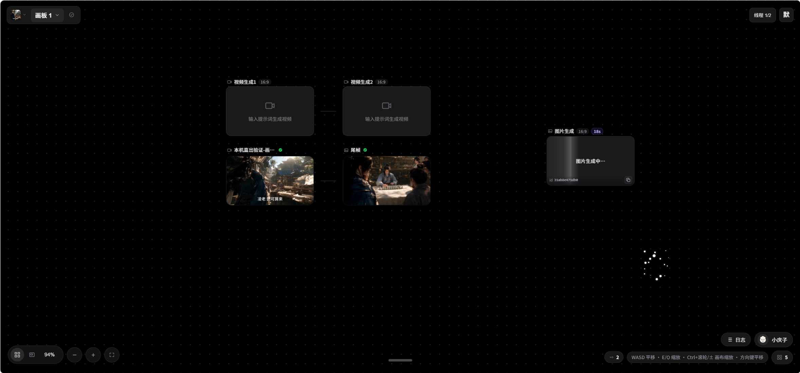

# 无限画布

我是一个漫剧爱好者。自己做漫剧时，总要把文案、分镜图、视频和配音串在一张画布上，现成工具要么太重，要么不适合一个人在家里用。所以我写了这个小工具，功能就这么简单，够自己用就行。

现在把源码公开出来，希望大家合理使用：自己学习、自己做漫剧都可以。不要拿去卖、不要拿去收费、不要拿去商用。完整约定在 [LICENSE](LICENSE) 和 [DISCLAIMER.md](DISCLAIMER.md)。软件按现状提供，不保证一直好用。

画布本身不内置模型账号。图、视频、文本、语音都走你自己填的 MyApi 或公共模型接口。密钥和画板只存在本机 `data/`，这个目录不会进仓库。



## 能做什么

- 在一张画布上放文本、图片、视频、音频，连线后一起生成
- 设置里填 MyApi 渠道（图片、视频、文本、语音、视觉、智能体），也可以填火山引擎 Key
- 视频超分：引擎是 [Real-ESRGAN ncnn Vulkan](https://github.com/xinntao/Real-ESRGAN)（BSD 许可证），第一次用时再下载，大约 45MB

## 你需要准备什么

- 一台能上网的电脑（Windows 最省事，macOS / Linux 也可以）
- [Python 3.10 或更高](https://www.python.org/downloads/)，安装时勾选 “Add python.exe to PATH”
- 一个你自己的模型接口和 Key（中转站或火山引擎都行，本项目不提供账号）
- 浏览器，推荐 Chrome 或 Edge

## 三分钟跑起来

先下载源码：点击仓库页面绿色的 **Code → Download ZIP**，解压后进入项目文件夹。安装了 Git 也可以执行：

```bash
git clone https://github.com/drkk5282-gif/Infinite-Canvas-Open-Source-Project.git
cd Infinite-Canvas-Open-Source-Project
```

Windows 双击 `start.bat`。它会装依赖，并同时打开画布（端口 10027）和任务服务（端口 8089）。两个黑窗口都留着，关掉就停了。

浏览器打开：http://127.0.0.1:10027

自己用命令行的话：

```bash
pip install -r requirements.txt
python -m backend.run_worker
```

另开一个终端：

```bash
python run.py
```

更细的点法写在 [使用教程](docs/使用教程.md)。想把这份源码传到 GitHub 或 Gitee，看 [开源上传教程](docs/开源上传教程.md)。

## 请不要提交这些东西

- `data/`：画板、上传的素材、你填的 API Key
- `.venv/`：本机装的 Python 包
- `.env`：如果以后你自己加了环境变量
- `*.zip`：旧压缩包和打包产物，避免把旧配置一起传上来

仓库里的 `.gitignore` 已经排除了它们。发出去之前再看一眼，确认压缩包和提交里没有密钥。

## 打包给自己用

```powershell
powershell -ExecutionPolicy Bypass -File scripts\build_release.ps1
```

产物在 `dist\CanvasServer-py\`，另外会有 `CanvasServer-py-portable.zip`。对方电脑也要先装 Python 3.10+，解压后双击启动脚本，第一次会自己建 `.venv` 并装依赖。

## 它是怎么跑的

1. 画布页面负责界面、画板和 MyApi 配置
2. 8089 上的任务服务负责真正去请求模型接口
